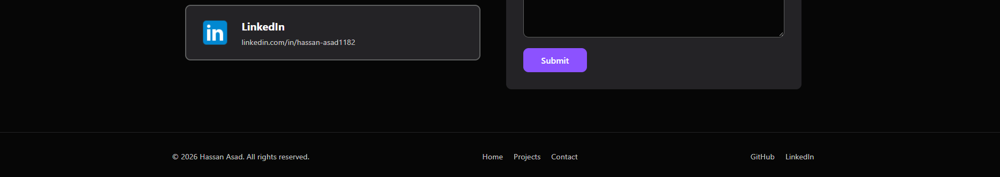

# Personal Portfolio Website

**Devixo Solutions, Web Development Internship Program, Task 01**

## Project Description

A modern, fully responsive personal portfolio website for Hassan Asad, a Software Engineering graduate and Python backend developer. The site presents my profile, skills, education, projects, and contact information in a clean dark themed interface.

The whole website is written in plain HTML5 and CSS3. No CSS frameworks, UI libraries, or downloaded templates were used.

## Technologies Used

- HTML5 (semantic elements)
- CSS3 (Flexbox, Grid, custom properties, media queries, transitions, keyframe animations)
- Git and GitHub
- Visual Studio Code

## Website Features

- Sticky navigation bar with a logo and links to every section
- Smooth scrolling between sections
- Hero section with name, tagline, introduction, call to action button, and resume button
- Profile photo with a rotating dashed ring and a terminal style info box
- About section with a statement, academic background, career interests, and professional summary
- Skill cards grouped by category and a moving marquee of the languages I know
- Education cards with a short description for each degree or course
- Project cards that lift on hover and show extra information, each with a GitHub button
- Contact section with GitHub and LinkedIn cards and a contact form UI (no backend)
- Hover animations on buttons, links, cards, and social icons
- Footer with copyright, quick links, and social links
- Responsive layout for desktop, laptop, tablet, and mobile with no horizontal scrolling

## Project Structure

```
portfolio/
├── index.html
├── style.css
├── README.md
├── images/
│   ├── logo.svg
│   ├── profile.png
│   ├── project1.png
│   ├── project2.jpg
│   ├── project3.png
│   └── icons/
│       ├── c++.png
│       ├── css.png
│       ├── django.png
│       ├── flask.png
│       ├── github.png
│       ├── html.png
│       ├── javascript.png
│       ├── linkedin.png
│       ├── python.png
│       ├── sql.png
│       ├── tailwind.png
│       └── typescript.png
├── resume/
│   └── Hassan_Asad_Resume.pdf
├── screenshots/
│   ├── About section.png
│   ├── Contact section.png
│   ├── Education section.png
│   ├── Footer.png
│   ├── Home hero section.png
│   ├── Mobile view.png
│   ├── Projects section.png
│   └── Skills section.png
└── report/
    └── Task01_Report.pdf
```

## Screenshots

### Desktop

**Home**


**About**


**Skills**


**Education**


**Projects**


**Contact**


**Footer**



### Mobile


## How to Run the Website

1. Download or clone the repository:
   ```
   git clone https://github.com/HassanAsad118/your-repo-name.git
   ```
2. Open the project folder.
3. Double click `index.html` to open it in any web browser (Chrome, Edge, Firefox).

No installation or build steps are needed.

## Author

**Hassan Asad**

GitHub: [HassanAsad118](https://github.com/HassanAsad118)
